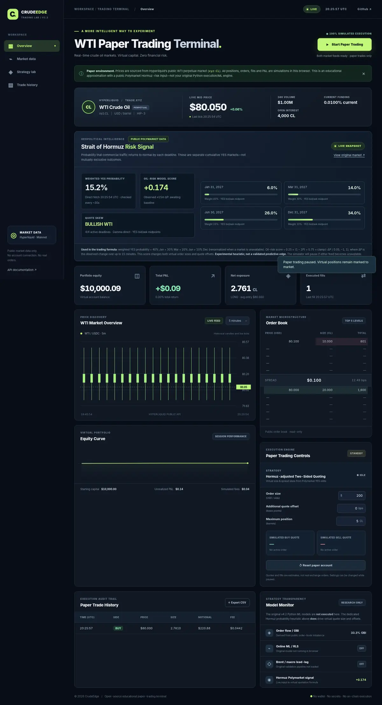

# CrudeEdge v1.4 — Handwritten Quant Notebook Paper Trading Terminal

A shareable, English-language **GitHub Pages** paper-trading terminal with a genuinely hand-drawn graph-paper UI, animated price pencil and live-changing formula values. It uses read-only **public Hyperliquid `xyz:CL` WTI** data **and live-read public Polymarket Strait of Hormuz probabilities** to adjust a hypothetical two-sided virtual quoting strategy. No user account, wallet, key, backend, real order or installation is required.

**The Hormuz probability feed is a real formula input** (not merely a widget). This is a standalone browser educational simulator, **not** the original Python ML engine and **not** a validated trading strategy.

**[Open the PaperTradeWTI dashboard](https://leendertvang-dot.github.io/PaperTradeWTI/)** (live site requires a successful GitHub Pages deployment).



*Illustrative preview with synthetic test prices, **not** a current market quote.*

## What's new in v1.4

- **Flat math-notebook aesthetic:** light paper texture, blue graph-paper rulings, a red margin line and handwritten-style annotations. There is **no open-book mockup** or static background photo.
- **Live pencil marker:** an inline SVG pencil follows the latest plotted **real WTI market observation**. It is hidden whenever the feed is not current; smooth movement respects reduced-motion settings.
- **Changing-number feedback:** new numeric values pulse green for increases and red for decreases (actual observed changes only).
- **12-value transparent input board:** best bid, best ask, spread, order-book imbalance, Polymarket weighted YES probability, observed probability delta, risk score, virtual inventory, both quote offsets and both posted virtual notionals.
- **Quote math display:** live Hormuz probability → score → bid/ask offset breakdown; the score **really affects posted virtual paper prices and size**, subject to a cash and inventory cap.
- **Read-only `para:10Y` panel:** uses Hyperliquid public `l2Book` Info requests to display its **own** indicative midprice when available. It is a separate rates/reference market and **does not masquerade as a WTI proxy or change the WTI formula**. If unavailable, it displays an unavailable state and never invents a value.
- **Safe GitHub update:** the original `.github/workflows` hierarchy and keyless scheduled Polymarket snapshot remain unchanged.

The preview shows **synthetic mock-feed test values**, not current prices or investment performance.

## Update existing repository `leendertvang-dot/PaperTradeWTI`

Use **GitHub Desktop** for replacing the project safely. In particular, dragging the extracted directories into GitHub's web upload form may flatten the `.github` hierarchy.

1. In GitHub Desktop, select **File → Clone repository**, then choose `leendertvang-dot/PaperTradeWTI` and clone it (skip cloning if you already have it locally).
2. Download and extract the v1.4 ZIP. In Windows Explorer, open the extracted folder and **copy all contents**, including `.github`, `assets`, `scripts`, and `tests`, into your locally cloned `PaperTradeWTI` directory. Replace existing files; **do not delete** the local hidden `.git` folder.
3. In GitHub Desktop, inspect the Changes tab, enter commit summary `CrudeEdge v1.4 handwritten notebook redesign`, click **Commit to main**, then **Push origin**.
4. Visit [Actions](https://github.com/leendertvang-dot/PaperTradeWTI/actions) and verify both **Validate safe public paper trading app** and **Deploy public dashboard with Hormuz market snapshots** finish green. In Settings → Pages, keep Source set to **GitHub Actions**.
5. Visit [the public dashboard](https://leendertvang-dot.github.io/PaperTradeWTI/). If the browser retains old CSS, use Ctrl+F5 to reload.

The update does not upload anyone's browser-local paper positions. No GitHub repository secrets are necessary.

## Features

- Clear **Start Paper Trading** and **Pause Trading** controls; live **Hyperliquid and Polymarket** feeds are both required to start.
- Live WTI (`xyz:CL`) top-of-book, price, spread and public market snapshot.
- Historical candle **closes** are shown as a red, hand-drawn-style line, with live WTI ticks moving the pencil tip. Candles are retrieved from Hyperliquid’s read-only Info API.
- Fully simulated trades with a $10,000 initial virtual balance, virtual P&L/equity, position limits, hypothetical maker fees, trade history and CSV export.
- Session data saved **only in the visitor's browser** via `localStorage` (never uploaded).
- A dedicated **Hormuz Risk Signal** dashboard: four deadline probabilities, weighted composite YES probability, 15-minute observed change, oil-risk score and live virtual order skew.
- Transparent strategy monitor; **only** the new documented Hormuz-tilted paper strategy runs in-browser; original Python online RLS/ML and Brent/macroeconomic pipelines are **not** running.
- Responsive, static, no-build hosting; can be published on GitHub Pages.

## Deploy to GitHub Pages (easy)

1. Create a **new public repository** on GitHub (for example, `crudeedge-paper-trading`).
2. Unzip the release and upload **all its contents**, including the **hidden `.github` folder**, `assets`, `scripts` and `tests`, directly to the repository root. **Do not upload the ZIP as a single file. Never upload the original source ZIP.** Commit the files to the `main` branch.
3. In the repository, open **Settings → Pages**. Under **Build and deployment → Source**, choose **GitHub Actions** (not “Deploy from a branch”).
4. Open the **Actions** tab. If GitHub requests permission to enable workflows, enable them. Select **Deploy public dashboard with Hormuz market snapshots** and choose **Run workflow** on `main` to create the initial site/snapshot. (A push to `main` will usually trigger it automatically.)
5. After the workflow succeeds, your link is `https://YOUR-USERNAME.github.io/YOUR-REPOSITORY/`. The scheduled workflow refreshes the public Polymarket snapshot every ~10 minutes (GitHub scheduling is best effort). No private keys or repository secrets are needed.

Visitors can inspect charts and start independent virtual sessions. Hyperliquid is browser-live. Polymarket is queried directly when browser CORS permits, or via the included scheduled **same-origin GitHub Pages snapshot** when direct requests are blocked. Users never need a Polymarket account. A shared GitHub Pages URL does **not** share a user's saved trades between visitors.

## Run locally

Serve the folder using an HTTP server (opening `index.html` directly via `file://` may fail security/CORS restrictions):

```bash
python scripts/fetch_hormuz_snapshot.py  # optional but recommended for local CORS fallback
python -m http.server 8000
```

Open http://localhost:8000/ in the browser. Requires an internet connection and browser access to Hyperliquid. No Python package installation, build step or backend service is required.

## Market data (public / read-only)

The app sends read-only requests only to **public market-data endpoints**:

| Source | Endpoint | Purpose |
| --- | --- | --- |
| Hyperliquid Info API | `POST https://api.hyperliquid.xyz/info` | `metaAndAssetCtxs` with `dex: "xyz"`; `candleSnapshot` for `xyz:CL` |
| Hyperliquid public WebSocket | `wss://api.hyperliquid.xyz/ws` | Subscribe to `l2Book` and `trades` for `xyz:CL`, `allMids` for `xyz` |
| Hyperliquid 10Y reference | `POST https://api.hyperliquid.xyz/info` | Public `l2Book` query for `para:10Y` (independent reference market; **not** a WTI signal) |
| Polymarket Gamma API | `GET https://gamma-api.polymarket.com/events/slug/strait-of-hormuz-traffic-returns-to-normal-byptptpt` | Browser-direct public read when CORS permits; read YES prices |
| GitHub Pages same-origin snapshot | `GET ./data/hormuz-snapshot.json` | Automatic fallback, generated from the **same Gamma event** by a public GitHub Actions cron job (approximately every 10 minutes, potentially delayed) |

The **public** WTI perpetual identifier is `xyz:CL` (Trade[XYZ], HIP-3), not native front-month NYMEX crude futures. Actual access and data depend on Hyperliquid service availability, market listing, browser network rules and rate limits. If the feed drops or goes stale, the simulator automatically pauses. A disconnected page never invents fake live market prices.

Docs: [Hyperliquid API](https://hyperliquid.gitbook.io/hyperliquid-docs/for-developers/api/info-endpoint), [WebSocket subscriptions](https://hyperliquid.gitbook.io/hyperliquid-docs/for-developers/api/websocket/subscriptions), [Polymarket event](https://polymarket.com/event/strait-of-hormuz-traffic-returns-to-normal-byptptpt), [Polymarket public market discovery](https://docs.polymarket.com/market-data/discover-markets). All data requests are **read-only**. Public Gamma browser CORS can vary by network and region. The bundled GitHub Actions workflow fetches and publishes the same public event as a timestamped, sanitized JSON file on your own GitHub Pages domain—**no third-party CORS proxy or hard-coded odds**. The fallback must be newer than 45 minutes; otherwise trading stays disabled, rather than inventing odds.

## Actual Hormuz market input and formula

The app looks up **this exact Polymarket event slug only**: [Strait of Hormuz traffic returns to normal by...?](https://polymarket.com/event/strait-of-hormuz-traffic-returns-to-normal-byptptpt). It does **not** use unrelated "Will WTI hit $100?" contracts. It selects the active, future-dated YES markets for these explicit deadlines:

| Cumulative YES deadline | Model weight |
| --- | ---: |
| January 31, 2027 | 40% |
| March 31, 2027 | 30% |
| June 30, 2027 | 20% |
| December 31, 2027 | 10% |

Weights renormalize when a deadline is unavailable; **at least two validated active deadline markets** must be available or the strategy is disabled. These are four *cumulative* events; their implied probabilities are **not summed to 100%** and should not be confused with four exclusive outcomes. For each deadline, prefer the midpoint of a plausible two-sided YES bid/ask; if unavailable, use an *indicative* Gamma YES outcome price and disclose that fact in the UI. This is **not** a guarantee of tradeable prices or quote age.

Let \(p_i\) be the probability from market \(i\), and let \(w_i\) be its weight. The experimental browser-only strategy computes:

```text
P      = SUM(w_i * p_i) / SUM(w_i)        // composite probability [0, 1]
deltaP = P(now) - P(oldest sample in the last 15 min)
trend  = clamp(-deltaP / 0.05, -1, 1)    // first sample: trend = 0
score  = clamp(0.25*(1 - 2*P) + 0.75*trend, -1, 1)

bid_notional = user_notional * (1 + 0.60*score)
ask_notional = user_notional * (1 - 0.60*score)
bid_offset_bps = user_offset_bps + 3*max(0, -score)
ask_offset_bps = user_offset_bps + 3*max(0,  score)

paper_bid = live_hyperliquid_best_bid * (1 - bid_offset_bps / 10000)
paper_ask = live_hyperliquid_best_ask * (1 + ask_offset_bps / 10000)
```

So falling odds of normalization yield a **positive** oil-risk score: the virtual bid becomes relatively larger/more competitive while the virtual ask becomes relatively smaller/further away. Rising odds do the opposite. **This logic is a transparent research heuristic, not a statistical forecast, empirically validated coefficient set or investment recommendation.** It may respond to stale, illiquid or already-priced-in Polymarket information. Price direction is not guaranteed.

The browser checks Polymarket about every 30 seconds. It tries public Gamma directly first, then automatically loads a **same-origin, GitHub Actions-generated snapshot** when browser CORS disallows Gamma. The GitHub workflow requests the real public market approximately every 10 minutes and republishes the static site. The dashboard clearly labels “LIVE SNAPSHOT” versus “GITHUB SNAPSHOT” with the source timestamp. The first sample produces a level-only signal; later samples also use observed probability change, capped at 15 minutes of browser memory. **No persisted historical baseline, backtest or fabricated odds.** The simulator refuses new activity if a direct Polymarket feed is older than two minutes, a GitHub source snapshot is older than 45 minutes, a browser check is older than two minutes, or the Hyperliquid book is older than 30 seconds. An unavailable feed disables Start and pauses ongoing simulation. The risk signal does **not** send orders to Polymarket or Hyperliquid.

## Virtual fill simulation

When the user clicks **Start Paper Trading**, the app posts **hypothetical** two-sided virtual quotes with the above sizes and offsets, subject to user-configured maximum absolute inventory and a simplified cash assumption. A paper fill is recorded only when a fresh public Hyperliquid aggressive trade **timestamped after the displayed virtual quote became active** crosses that quote with available quantity. Older trades cannot retroactively fill new quotes. There is a 2.2-second minimum interval between fills and a **hypothetical fee of 2 basis points (0.02%)** per fill. The portfolio is marked at the available public WTI price.

**Limitations:** Exchange orders are **never** submitted. Estimated touch/trade-through fills omit order queue priority, latency, actual maker eligibility, slippage, hidden liquidity, funding, margin and liquidation, mark/settlement details and trading-specific fee schedules. The original package's online RLS ML, market-flow execution and macro model are not running. A static website is not a reliable historical trading-performance test.

## Security / safe to share

- Built **from scratch**, not by copying all files from the original uploaded ZIP.
- This package does **not** contain `.env`, backups, private key material, wallet addresses, personal trading logs, `.venv`, history files or saved ML state.
- There is **no exchange execution endpoint**, wallet connection, cryptographic signing, transaction approval, private backend or credential field in this project.
- The app has a restrictive Content Security Policy; browser connections are restricted to same-origin GitHub Pages, Hyperliquid public Info/WebSocket and Polymarket public Gamma endpoints.
- `.gitignore` blocks accidental addition of common credential file types if you add other files later.
- No tracking/analytics or external code dependencies.

**Important:** A public dashboard can never protect credentials that you manually insert into its JavaScript later. If you have ever uploaded the **original** ZIP or `.env` to any public repository, remove the data from **git history** and **rotate those credentials**; merely deleting them in the latest commit is insufficient.

## Files

```
index.html                      English-language dashboard and controls
styles.css                      Responsive dark UI
app.js                          Read-only Hyperliquid + Gamma polling and virtual fills
hormuz-signal.js                Auditable pure probability/model formula
scripts/fetch_hormuz_snapshot.py Public event-to-JSON fetch (GitHub Actions)
scripts/build_site.py           Publish-only allowlisted website artifact
.github/workflows/pages.yml     Pages deploy and 10-minute snapshot refresh
assets/favicon.svg              Icon
assets/dashboard-preview.webp    GitHub preview screenshot (synthetic/mock prices)
.github/workflows/validate.yml  GitHub Actions validation on push / PR
.nojekyll                       GitHub Pages compatibility
.gitignore                      Blocks common credentials and local artifacts
tests/hormuz_signal.test.cjs    Formula/unit tests with mocked market data
tests/security_checks.py        Strict public file/secret/route audit
tests/test_snapshot.py          Offline tests for success, network failure and wrong-market protection
README.md                       Deployment, explanation and risk disclosure
AUDIT_REPORT.md                 Final release security and functional audit
LICENSE                         MIT license
```

## Test before publishing

Run the dependency-free tests from this folder (Node 22 and Python 3):

```bash
node --check app.js
node --test tests/hormuz_signal.test.cjs
python tests/security_checks.py
python -m unittest discover -s tests -p "test_*.py"
```

The `.github/workflows/validate.yml` CI runs these tests on push and pull request. The separate `pages.yml` pipeline fetches the live public Polymarket event and deploys the static site. **If Polymarket cannot be reached, the dashboard still deploys, but its snapshot contains no odds and paper trading stays disabled** until a valid source is available; its `scripts/` contain **no account credentials**. The signal test uses synthetic prices, not real orders. Browser connectivity depends on Hyperliquid, public Gamma availability, the GitHub Pages deployment/schedule and regional/network access; passing unit tests cannot guarantee all live providers are reachable. If the event becomes inactive or the deadlines/slug change, the paper strategy deliberately fails closed until reviewed.


## License

MIT license. This is an educational trading simulation, not investment advice. CrudeEdge is not affiliated with Hyperliquid, Polymarket, Trade[XYZ], or NYMEX.

## Release audit (v1.2 · November 23, 2026)

The distributable archive contains only the files listed above and no original `.env`, wallet, local history, database or account exports. The read-only Hyperliquid and Polymarket API URLs are retained. Static checks and offline model/snapshot tests exercise the public data boundary. A mock-browser smoke test additionally exercised Start/Pause, synthetic fills, reset, and the mobile layout. GitHub workflow builds only an explicit list of deployable static files.

**Testing boundary:** The external Hyperliquid and Polymarket APIs were not reachable from the audit runtime, so an end-to-end live-market or real GitHub Pages deployment could not be certified here. Simulated/test fills are not proof of market-maker performance. Prior user private credentials must still be rotated if they were ever uploaded elsewhere.
